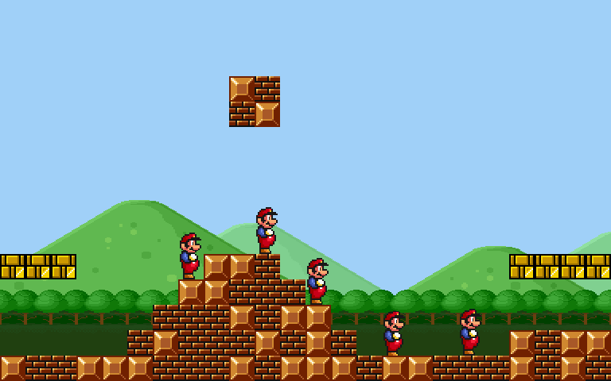

# Mario-Engine

A small 2D game engine written from scratch in C++ on SFML, with a Mario-style level as its test game.
Built in 2015–2016. This is an archived project: the code is kept as it was.



[Watch the demo as MP4](Screenshots/demo.mp4) · recorded in 2026 from the unmodified 2016 sources.
Mario spawns wherever `img/level.bmp` has a cyan pixel, and the keyboard drives every Mario at once:
for the demo, four extra cyan pixels give five Marios that jump, build and land on each other.

## What's inside

- Fixed-step game loop at 60 FPS (`processor.cpp`)
- Objects and groups with solid collisions and per-frame updates (`object.cpp`, `object_container.cpp`)
- Sprite-sheet animation (`animation.cpp`)
- Levels drawn as a bitmap, one pixel per tile (`test_level.cpp`, `img/level.bmp`)
- Camera that follows the player and stays inside the level (`level.cpp`)
- Mario physics: acceleration, friction, sprint, skid on turn (`mario.cpp`)

## Controls

| Key | Action |
|---|---|
| ← → | Walk |
| ↑ | Jump |
| Left Shift | Sprint |
| Space | Place a block under Mario |
| ↓ | Crouch |
| R | Respawn |

## Build

Originally a Visual Studio project with SFML 2.x: add the files from `MarioEngine/` to a project, link SFML
and run it from the `MarioEngine` folder, because the game loads `img/` from the working directory.

On Linux with g++ and SFML 2.6 (Ubuntu 24.04), the sources build unchanged. Two flags cover what MSVC used to accept:

```sh
sudo apt install g++ libsfml-dev
cd MarioEngine
mkdir -p ../build
echo 'void game_main(); int main() { game_main(); }' > ../build/shim.cpp
for f in *.cpp; do
  extra=""
  [ "$f" = main.cpp ] && extra="-Dmain=game_main"  # MSVC accepted `void main()`
  [ "$f" = object.cpp ] && extra="-Dfalse=0"       # MSVC accepted `return false;` from a pointer function
  g++ -std=c++17 -O2 -w $extra -c "$f" -o "../build/${f%.cpp}.o"
done
g++ ../build/*.o ../build/shim.cpp -o ../build/mario -lsfml-graphics -lsfml-window -lsfml-system
../build/mario
```
